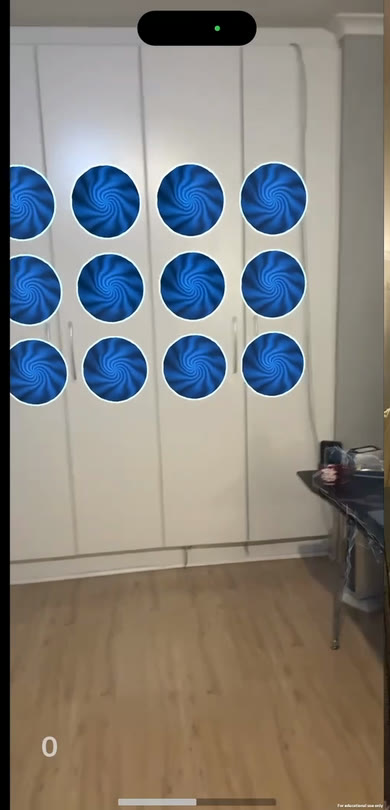
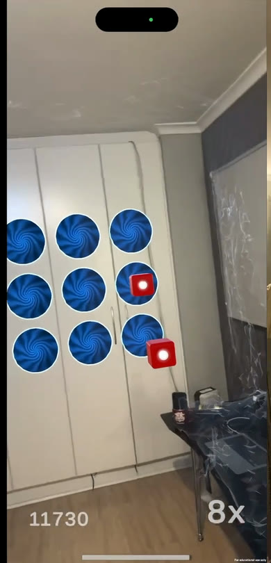
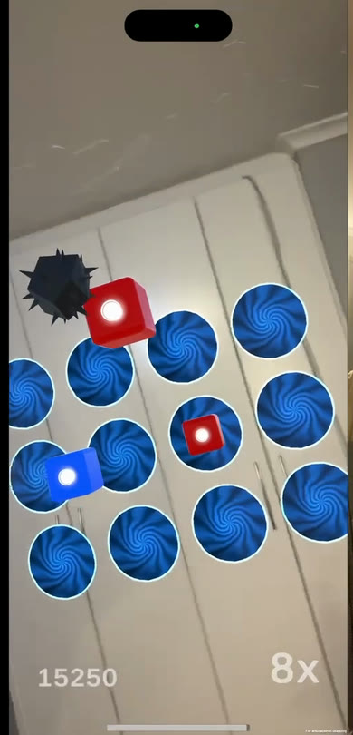
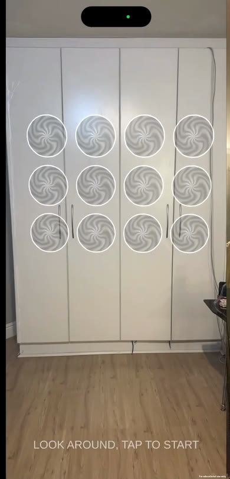

# Spatial Pulse

**A rhythm game you play in your own room, in augmented reality.** Point your iPhone at a wall and it opens a grid of glowing portals on it. Cubes fly out of the portals in time with a song from your phone, and you slice them by swinging the phone like a lightsaber.

  
  
  
  

**[Watch a full run](docs/media/demo.mp4)** (with sound) — picking a song, scanning the wall, placing the grid and playing.

## What it is

It's like Beat Saber, but instead of a VR headset it uses your iPhone and your actual room. The phone's LiDAR sensor measures the shape of the room so the game can find a flat wall and stick the portals to it. Everything else — the cubes, the timing, the slicing — happens in real 3D space around you.

## What you do

1. **Pick a song.** Choose any mp3 or wav that's on your phone.
2. **Point at a wall.** The game shows a see-through preview of the portal grid wherever the wall is flat enough.
3. **Tap to place it.** The grid turns solid and your song starts.
4. **Slice the cubes.** Cubes fly out of the portals on the beat. Swing the phone through them to score. Dodge the bombs.
5. **Get a grade.** At the end you get a score and a rating from E up to S.

The clever part: the game doesn't need a pre-made "beatmap" for your song. It listens to the music while it plays and works out where the beats are by itself, so *any* song on your phone works.

## What makes it interesting

- **It understands your room.** The game checks that a wall is genuinely flat before it places the grid — it probes four points and fits a plane through them, so the portals sit flush even on a slightly uneven wall.
- **Any song works.** There's no library of supported tracks. The game analyses the bass energy of whatever you pick and spawns cubes on the beats it finds.
- **The music stays in sync with the cubes.** The game deliberately delays the sound you hear by exactly the time a cube takes to reach you, so a cube arrives right on the beat you hear. Walk closer to the wall and it recalculates the delay automatically.
- **The sound follows the action.** The music comes from the direction of the nearest incoming cube, so it feels like the sound is travelling towards you with it.

## Running it

You need a Mac with Xcode and an iPhone that has LiDAR (a Pro model). It won't work in the simulator or on a non-LiDAR phone, because it genuinely needs the sensor.

1. Install Unity **6000.4.2f1** with the iOS build module and open this folder.
2. Open `Assets/Scenes/SampleScene.unity`, switch the build profile to iOS and build.
3. Open the Xcode project, set your signing team and run it on the phone.
4. Put an mp3 or wav on the phone (in the Files app) before you launch.

---

<b>Technical detail</b> — how it works, for a developer reader

### Finding a wall (`LiDARSpawner.cs`)

Each frame while scanning, the game casts a ray horizontally from the camera against the LiDAR mesh layer. A hit counts as a wall if the surface is near vertical (`|normal.y| < 0.3`) and at least 1.5 m away. Raw LiDAR meshes are noisy, so the hit is then checked for flatness:

1. Cast four probe rays at the corners of the area the grid would cover.
2. Fit a plane through the four hit points using the cross product of the two diagonals.
3. Reject the spot if any probe is more than 0.2 m off that plane.

If it passes, the grid snaps to the fitted plane, so the portals sit flush on the wall.

### Beat detection and sync (`LiDARSpawner.cs`)

Notes are generated from the audio at runtime, so any song works without a hand-made beatmap.

- A near-silent `analyzerSource` plays the song and `GetSpectrumData` reads a 1024-bin spectrum. Energy in the lowest bins is summed, and a spike above `beatThreshold` schedules a note.
- The audible copy plays from a separate 3D emitter using `PlayScheduled`, delayed by the note travel time (player-to-wall distance divided by note speed). The music you hear is late by exactly the time a cube takes to reach you, so the cube arrives on the beat you hear.
- Travel time is recomputed from the player's current distance, so walking towards or away from the wall doesn't break the timing.
- The music emitter drifts towards the cube nearest the player. Bombs make up about 5% of spawns.

### Other scripts

| Script | Role |
|---|---|
| `UIManager.cs` | Start, scanning, HUD and game-over screens. Opens the iOS file picker and loads the file with `UnityWebRequestMultimedia`. |
| `SaberBlade.cs` | Trigger on the camera. Handles hits and bombs: sound, particles, score, health, haptics. |
| `ScoreManager.cs` | Score, combo and multiplier, plus on-screen feedback. |
| `HealthManager.cs` | Energy bar and fail condition. |
| `MissZone.cs` | Follows the player's depth and removes notes that weren't hit, applying the miss penalty. |
| `NoteBehavior.cs` | Moves a note forward and removes it after 8 seconds. |

### Scoring and health

Each hit scores 10 × a combo multiplier (2x from a combo of 2, 4x from 6, 8x from 14). A miss or bomb resets the combo. Energy starts at 50/100; a hit gives +5, a miss costs 15 and a bomb costs 30. At zero the level fails.

<b>Third-party assets and credits</b>

Included so the project opens and runs as built. Each belongs to its owner.

- **NativeFilePicker** by Yasir Kula (MIT) — the iOS file picker.
- **NamuFX AoeExplosions** — explosion effect for bombs.
- **Procedural Portal Effect** — the portal shader and prefabs.
- **TextMesh Pro** — Unity package resources.
- **Beat Saber logo** — used on the start screen. Beat Saber is a trademark of Beat Games; this is an unofficial, non-commercial student project.

The demo video contains background music that isn't mine. No audio files are in the repository.

<b>Known limitations</b>

- Beat detection uses only bass energy, so tracks without a strong low end produce sparse notes.
- Notes are placed randomly, not designed. Cube colours don't restrict swing direction.
- The grid has to fit on one flat wall; small or cluttered walls fail the flatness test.
- iOS only. AR Foundation for Android isn't set up.

---

Daniel Jackson · <a href="https://github.com/DanielJacksonRSA">GitHub</a> · code in <code>Assets/Scripts</code>: <a href="LICENSE">All rights reserved</a>

